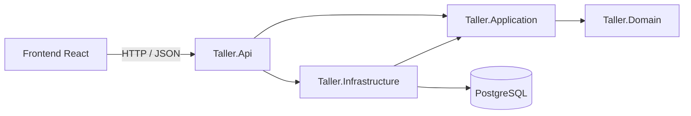

# Taller Metalúrgico

Sistema web para gestionar un taller metalúrgico: inventario de materiales, proveedores, órdenes de trabajo, recordatorios de pagos y usuarios.

> Proyecto personal en desarrollo. Backend en **ASP.NET Core (.NET 10)** y frontend en **React + TypeScript**.

## Funcionalidades previstas

- **Usuarios y roles**: Admin, Encargado y Operario.
- **Inventario**: materiales por kg, metro o unidad, stock mínimo, movimientos de entrada y salida, alerta de stock bajo y calculadora de peso de perfiles.
- **Proveedores**: contacto, materiales que vende cada uno e historial de precios (con importación de listas en Excel/CSV).
- **Órdenes de trabajo**: materiales, herramientas, tiempo estimado y real, responsable y estado.
- **Recordatorios**: pagos de servicios y proveedores con vencimientos recurrentes.
- **Clientes y presupuestos**: presupuestos con materiales, horas y margen, exportables a PDF.
- **Herramientas y máquinas**: asignación y mantenimiento.
- **Panel de inicio** y **auditoría** de cambios.
- **Cotización del dólar** desde la API oficial del BCRA, para seguir la variación de precios.

## Arquitectura

Monolito modular con Clean Architecture: las reglas del negocio no dependen de la base de datos ni del framework web.



| Proyecto | Responsabilidad |
|---|---|
| `Taller.Domain` | Entidades y reglas de negocio. Sin dependencias externas. |
| `Taller.Application` | Casos de uso, validaciones y DTOs. |
| `Taller.Infrastructure` | EF Core + PostgreSQL, Identity, servicios externos. |
| `Taller.Api` | Endpoints REST (Minimal APIs), OpenAPI, CORS, health checks. |
| `frontend/` | Aplicación React + TypeScript (Vite). |
| `tests/` | Pruebas unitarias (xUnit) y de integración (`WebApplicationFactory`). |

## Cómo ejecutarlo

### Opción 1: todo con Docker

Requiere [Docker Desktop](https://www.docker.com/products/docker-desktop/).

```bash
docker compose up --build
```

- Frontend: http://localhost:3000
- API: http://localhost:5080/api/version
- OpenAPI: http://localhost:5080/openapi/v1.json
- Estado: http://localhost:5080/health/ready

### Opción 2: desarrollo local

Requiere el [SDK de .NET 10](https://dotnet.microsoft.com/download/dotnet/10.0) y [Node.js 22](https://nodejs.org/).

```bash
# 1. Base de datos
docker compose up -d db

# 2. API (http://localhost:5080)
dotnet run --project src/Taller.Api

# 3. Frontend (http://localhost:5173), en otra terminal
cd frontend
npm install
npm run dev
```

### Pruebas

```bash
dotnet test Taller.slnx
```

## Hoja de ruta

- [x] Esqueleto de la solución, Docker y CI
- [ ] Usuarios, autenticación y roles
- [ ] Inventario y proveedores
- [ ] Órdenes de trabajo
- [ ] Recordatorios y tareas en segundo plano
- [ ] Clientes, presupuestos y PDF
- [ ] Panel de inicio, herramientas y auditoría

## Tecnologías

.NET 10 · ASP.NET Core · Entity Framework Core · PostgreSQL · React · TypeScript · Vite · Docker · GitHub Actions · xUnit
